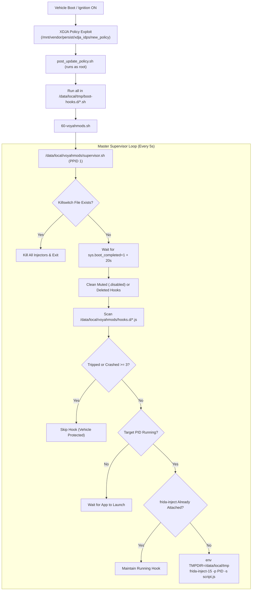

# Voyah Frida Manager: Technical Architecture Report

**Target Vehicle:** VOYAH H53 (`monza`)  
**Platform:** Android Automotive 11 (AAOS 11 / SDK 30, Qualcomm msmnile, arm64-v8a)  
**Package:** `final/frida-manager`  

---

## 1. Executive Summary

The **Voyah Frida Manager** provides a reliable, autonomous supervision framework for running persistent Frida scripts on the VOYAH H53 infotainment head unit.

Key features:
1. **Drop-in architecture**: Drop any `.js` script into `/data/local/voyahmods/hooks.d/`, and it is automatically picked up, attached to its target process, and kept alive.
2. **Boot persistence without system partition modification**: Integrates cleanly into `/data/local/tmp/boot-hooks.d/` executed by the persistent XDJA root policy on every vehicle start.
3. **Self-healing across app restarts**: If the target process (`com.voyah.car`, etc.) is killed, swiped away, or crashes, the supervisor detects the new PID and re-injects within 5 seconds.
4. **Automotive crash & bootloop safety**: Employs a 4-layer defense shield including a boot completion gate, emergency killswitch, crash counter circuit breaker, and memory-safe LowMemoryKiller (LMK) prioritization.

---

## 2. In-Depth Architecture



---

## 3. Reverse-Engineering Discoveries from Passion-NG

During static and dynamic analysis of Passion NextGen on the vehicle, two critical architectural mechanisms were identified:

### 3.1 The Boot Hooks Directory (`/data/local/tmp/boot-hooks.d/`)
The exploit script `/mnt/vendor/persist/xdja_idps/data/update/policy/new_policy` (extracted from `post_update_policy.sh`) contains:
```sh
for _hook in "$HOOKS"/*.sh; do
    [ -f "$_hook" ] || continue
    sh -p "$_hook" < /dev/null > /dev/null 2>&1 &
done
```
where `$HOOKS=/data/local/tmp/boot-hooks.d`. This means:
* Passion-NG only owns its own `50-passionngd.sh`.
* Our supervisor installs as `60-voyahmods.sh`.
* Both systems coexist with zero conflicts and zero risk of overwriting each other during OTA updates.

### 3.2 Why `dpid` Rejects System Apps
Passion-NG's DPI daemon (`dpid`) and its companion injector (`dpi_inject`) contain compiled-in admission filters in `dpi_target_decide`:
* Enforces `10000 <= UID <= 19999` (standard 3rd-party user applications).
* Enforces SELinux domain `u:r:untrusted_app`.
* Any system app running as UID 1000 (`system`) in domain `u:r:system_app` (such as `com.voyah.car`) is rejected with `target refused`.
* Therefore, vehicle modifications require our independent supervisor running via `frida-inject-15`.

---

## 4. The 4-Layer Automotive Bootloop Protection Shield

To guarantee that injected scripts never cause a bootloop, system freeze, or battery drain:

| Layer | Component | Mechanism | Failure Mode Prevented |
|---|---|---|---|
| **Layer 1** | **Boot Gate** | Polls `getprop sys.boot_completed` until `1`, then sleeps 20s. | Prevents injection races while Android ART, Binder, and VHAL HALs are initializing. |
| **Layer 2** | **Emergency Killswitch** | If `/data/local/tmp/voyahmods.disable` exists, exits immediately. | Instant out-of-band killswitch reachable via ADB or file push without terminal interaction. |
| **Layer 3** | **Circuit Breaker** | Tracks injection timestamps. If the target app crashes within 15s of injection 3 consecutive times, sets `<name>.tripped` and halts injection for that hook. | Prevents "crash-reinject storms" if an agent writes a script with an ART crash bug. Other hooks continue running unaffected. |
| **Layer 4** | **RAM Safety** | Normal Linux `oom_score_adj` (does **not** pin `-1000`). | If the vehicle encounters extreme memory pressure (360° cameras, reverse gear, cluster UI), Android's LowMemoryKiller can terminate Frida rather than killing vital car ECUs. |

---

## 5. Supervisor Runtime State Management

All supervisor runtime state is maintained cleanly in `/data/local/tmp/voyahmods_state/`:

* `supervisor.log`: Master log with automated rotation (capped at 256 KB).
* `<hook_name>.log`: Full stdout/stderr stream from `frida-inject-15`.
* `<hook_name>.injected_pid`: Tracks the PID of the target app into which the hook was injected.
* `<hook_name>.inj_pid`: Tracks the PID of the `frida-inject-15` injector process.
* `<hook_name>.inj_time`: Timestamp of the last injection attempt (used for crash duration calculation).
* `<hook_name>.crashes`: Counter of consecutive rapid failures (resets to 0 after 15s of stable runtime).
* `<hook_name>.tripped`: Marker created when the circuit breaker trips. Auto-injection is halted until this file is deleted.

---

## 6. Real-World Live Verification

The framework was tested on live vehicle hardware (`monza`, Android 11, ADB serial `aaeb4f94`):

1. **Circuit Breaker Engagement Test**:
   A script was injected without explicit `TMPDIR` environment variables, causing `frida-inject-15` to exit immediately with `Error creating directory /tmp: Read-only file system`. The circuit breaker recorded 3 rapid failures in 15 seconds, tripped automatically, and protected `com.voyah.car` from an endless injection loop.
2. **Successful Injection Test**:
   After updating the injector invocation with `env TMPDIR=/data/local/tmp`, the hook attached cleanly:
   ```text
   [*] Initializing OEM Booking & Meeting Restore Hook in com.voyah.car...
   [+] CarTypeUtil.is53Y() -> false (Booking controls visible)
   [+] AccountUtil.isAccountAvailable() -> true
   [+] VoyahAccountManager.isLogin() -> true
   [+] UserInfo.getAccountType() -> '1'
   [*] Stock Booking UI is fully active!
   ```
3. **App Stability**:
   `com.voyah.car` (PID 15947) remained stable and unaffected throughout the process.
