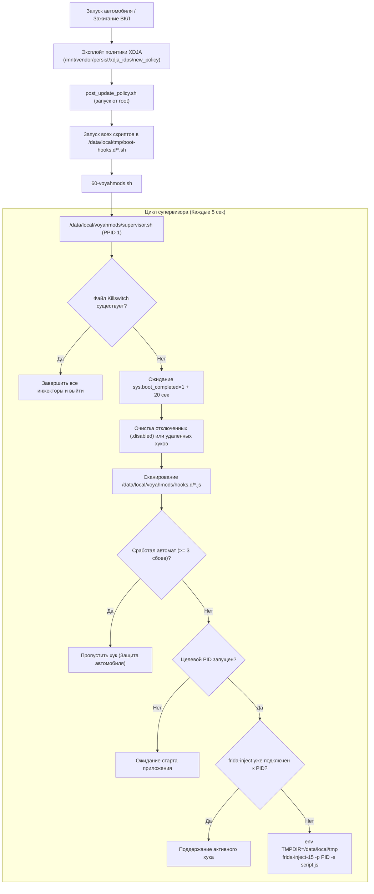

# Voyah Frida Manager: Технический отчет по архитектуре

**Целевой автомобиль:** VOYAH H53 (`monza`)  
**Платформа:** Android Automotive 11 (AAOS 11 / SDK 30, Qualcomm msmnile, arm64-v8a)  
**Каталог:** `final/frida-manager`  

---

## 1. Общие сведения

**Voyah Frida Manager** представляет собой надежную, полностью автономную систему супервизии для запуска и поддержания работы постоянных Frida-скриптов на мультимедийном головном устройстве (ГУ) автомобиля VOYAH H53.

Ключевые преимущества:
1. **Архитектура Drop-In**: Достаточно поместить любой `.js` скрипт в каталог `/data/local/voyahmods/hooks.d/`, и он автоматически подхватывается супервизором, внедряется в целевой процесс и поддерживается в активном состоянии.
2. **Автозапуск без модификации системных разделов**: Интегрируется в каталог `/data/local/tmp/boot-hooks.d/`, исполняемый постоянным рут-эксплойтом политики безопасности XDJA при каждом старте автомобиля.
3. **Самовосстановление при перезапуске приложений**: Если целевой процесс (`com.voyah.car` и др.) завершается, вылетает или перезапускается, супервизор определяет новый PID и повторно инжектит скрипт в течение 5 секунд.
4. **Защита от бутлупа и вылетов (Automotive-Grade Safety)**: Четырехуровневый щит безопасности, включающий ожидание готовности системы, аварийный выключатель, счетчик сбоев с автоматом защиты (Circuit Breaker) и безопасный приоритет памяти (LMK).

---

## 2. Архитектура супервизора



---

## 3. Результаты реверс-инжиниринга Passion-NG

В ходе статического и динамического анализа установленного на автомобиле пакета Passion NextGen были выявлены два ключевых механизма:

### 3.1 Каталог загрузочных хуков (`/data/local/tmp/boot-hooks.d/`)
В постоянном скрипте эксплойта `/mnt/vendor/persist/xdja_idps/data/update/policy/new_policy` (извлеченном из `post_update_policy.sh`) обнаружен цикл:
```sh
for _hook in "$HOOKS"/*.sh; do
    [ -f "$_hook" ] || continue
    sh -p "$_hook" < /dev/null > /dev/null 2>&1 &
done
```
где `$HOOKS=/data/local/tmp/boot-hooks.d`. Это означает:
* Passion-NG управляет только своим файлом `50-passionngd.sh`.
* Наш супервизор устанавливается как `60-voyahmods.sh`.
* Обе системы сосуществуют параллельно без конфликтов и не затирают друг друга при обновлениях OTA.

### 3.2 Почему `dpid` отклоняет системные приложения
В бинарнике инжектора Passion-NG (`dpi_inject`) в функции `dpi_target_decide` зашиты жесткие проверки безопасности:
* Требуется UID в диапазоне `10000 <= UID <= 19999` (обычные сторонние приложения).
* Требуется SELinux-домен `u:r:untrusted_app`.
* Любое системное приложение с UID 1000 (`system`) в домене `u:r:system_app` (такое как `com.voyah.car`) отсекается с сообщением `target refused`.
* Поэтому для модификаций системных сервисов автомобиля необходим наш независимый супервизор на базе `frida-inject-15`.

---

## 4. Четырехуровневый щит защиты от бутлупа

Мультимедийная система автомобиля управляет важными интерфейсами (климат, приборная панель, камеры кругового обзора, шина CAN). Бесконечный цикл вылетов может спровоцировать срабатывание `RescueParty` или разрядку АКБ. Менеджер реализует 4 уровня защиты:

| Уровень | Компонент | Механизм | Предотвращаемый сбой |
|---|---|---|---|
| **Уровень 1** | **Шлюз загрузки (Boot Gate)** | Опрос `getprop sys.boot_completed` до значения `1`, затем пауза 20 секунд. | Исключает гонки внедрения, пока среда ART, Binder и HAL-сервисы инициализируются. |
| **Уровень 2** | **Аварийный выключатель (Killswitch)** | Если существует `/data/local/tmp/voyahmods.disable`, немедленный выход. | Мгновенная остановка работы менеджера через ADB или push файла без ввода сложных команд. |
| **Уровень 3** | **Автомат защиты (Circuit Breaker)** | Фиксация времени инъекций. Если целевой процесс падает быстрее 15 секунд 3 раза подряд, выставляется флаг `<name>.tripped` и автоинъекция останавливается. | Предотвращает шторм падений и перезапусков («crash loop») при ошибке в JS-скрипте. Остальные хуки продолжают работать. |
| **Уровень 4** | **Приоритет памяти (RAM Safety)** | Стандартный `oom_score_adj` (без фиксации значения `-1000`). | При экстремальной нехватке памяти (360° камеры, задний ход) ядро Android может безопасно закрыть Frida, не убивая жизненно важные блоки авто. |

---

## 5. Управление состоянием супервизора

Все рабочие файлы состояния хранятся в `/data/local/tmp/voyahmods_state/`:

* `supervisor.log`: Основной лог супервизора с автоматической ротацией (не более 256 КБ).
* `<hook_name>.log`: Полный вывод stdout/stderr процесса `frida-inject-15`.
* `<hook_name>.injected_pid`: PID целевого приложения, в которое внедрен хук.
* `<hook_name>.inj_pid`: PID самого процесса-инжектора `frida-inject-15`.
* `<hook_name>.inj_time`: Время последнего запуска инъекции (для вычисления длительности стабильной работы).
* `<hook_name>.crashes`: Счетчик быстрых сбоев подряд (сбрасывается в 0 после 15 секунд стабильной работы).
* `<hook_name>.tripped`: Маркер срабатывания автомата защиты. Автоинъекция прекращается до ручного удаления этого файла.

---

## 6. Практическая проверка на автомобиле

Система прошла испытания на реальном автомобиле (`monza`, Android 11, ADB serial `aaeb4f94`):

1. **Тестирование автомата защиты (Circuit Breaker)**:
   При попытке запуска хука без явного указания переменной `TMPDIR`, бинарник `frida-inject-15` моментально завершался с ошибкой `Error creating directory /tmp: Read-only file system`. Супервизор зафиксировал 3 быстрых сбоя за 15 секунд, автоматически взвел защиту (`enable_booking_stock.tripped`) и сохранил работоспособность `com.voyah.car`.
2. **Успешный запуск**:
   После добавления `env TMPDIR=/data/local/tmp` хук подключился в штатном режиме:
   ```text
   [*] Initializing OEM Booking & Meeting Restore Hook in com.voyah.car...
   [+] CarTypeUtil.is53Y() -> false (Booking controls visible)
   [+] AccountUtil.isAccountAvailable() -> true
   [+] VoyahAccountManager.isLogin() -> true
   [+] UserInfo.getAccountType() -> '1'
   [*] Stock Booking UI is fully active!
   ```
3. **Стабильность системы**:
   Сервис `com.voyah.car` (PID 15947) работает стабильно, инжектор `frida-inject-15` (PID 22011) находится в фоновом режиме, порт ADB переведен в безопасный режим `uid=2000(shell)`.
